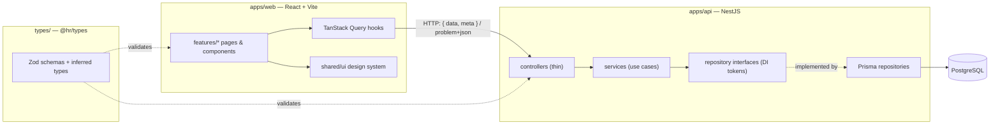

# HR Payroll

Employee management and payroll calculation for an HR team: a NestJS API, a React web client and a shared TypeScript contract, in one pnpm monorepo. Built for the Interface full-stack code assessment (2026).

> **Status:** employees, payroll (tax tables, social insurance, pay items, payslip), authentication with HR / EMPLOYEE roles, API docs and the web screens are done. Docker images and CI are next — see [Roadmap](#roadmap).

## Documentation

Full docs live in [`docs/`](docs/README.md):

1. [Getting started](docs/getting-started.md) — setup, scripts in order, demo accounts, testing the flow
2. [Architecture](docs/architecture.md) — monorepo, folder structure, layering
3. [Shared types & schemas](docs/shared-contract.md)
4. [API responses & error handling](docs/api-responses-and-errors.md)
5. [Authentication & authorization](docs/authentication.md)
6. [Employees](docs/employees.md)
7. [Payroll & payslip](docs/payroll.md) — marginal brackets, social insurance cap, allowances, deductions
8. [API docs (Swagger)](docs/api-docs.md)
9. [Design system](docs/design-system.md)
10. [Tech stack & packages](docs/tech-stack.md)
11. [Development process](docs/development-process.md) — spec-driven + test-driven

## Quick start

Requirements: Node ≥ 22.12, pnpm 10, Docker.

```bash
pnpm install && cp .env.example .env    # then set JWT_ACCESS_SECRET: openssl rand -base64 48
docker compose up -d db && pnpm --filter api db:migrate && pnpm --filter api db:seed && pnpm dev
```

Demo accounts (password `test@123`): `test@hr.com` (HR) · `test@employee.com` (EMPLOYEE). Full walkthrough in [Getting started](docs/getting-started.md).

| What | Where |
|---|---|
| Web app | http://localhost:5173 (design system preview: `/design-system`) |
| API | http://localhost:3000 |
| API docs (Swagger UI) | http://localhost:3000/docs — raw spec at `/docs-json`, committed copy in [`docs/openapi.json`](docs/openapi.json) |

> **Port 5432 already in use?** A Postgres installed on your machine shadows the container (`P1010 User was denied access`). Stop it (`brew services stop postgresql`) or change `POSTGRES_PORT` and `DATABASE_URL` in `.env`.

### Commands

| Command | Does |
|---|---|
| `pnpm dev` | builds `@hr/types`, then runs types watcher + API + web |
| `pnpm test` | all unit tests (types, API, web) |
| `pnpm --filter api test:e2e` | API end-to-end tests (in-memory fakes, no database) |
| `pnpm typecheck` · `pnpm lint` · `pnpm build` | across every package |
| `pnpm --filter api db:migrate` · `db:seed` | apply migrations · load seed data (idempotent) |
| `pnpm --filter api docs:export` | regenerate `docs/openapi.json` (no database needed) |

## Architecture



```
apps/api/src/
  common/         cross-cutting: error filter, response envelope, Zod pipe, CSRF middleware, clock, config
  auth/           login/refresh/logout, JWT guard, roles guard, password hasher, user + refresh-token repositories
  employees/      module · controller · service · repository interface · Prisma repository · errors · profile-image/
  departments/    same shape, read-only
  payroll/        domain/ (pure calculator) · tax-tables/ · social-insurance/ · pay-items/ · payslip/
  docs/           OpenAPI generated from the Zod schemas
  prisma/         PrismaService (schema, migrations and seed live in apps/api/prisma/)
apps/web/src/
  app/            providers, router, layout
  features/       employees/ · payroll/ — each with api/ (TanStack Query hooks), components/, form/, pages/
  shared/http/    axios client: every error becomes a typed ApiError (Problem Details)
  shared/theme/   design tokens (CSS custom properties) + breakpoints
  shared/ui/      Button, TextInput, SelectInput, Toast, Skeleton, Card, Avatar, Badge, ConfirmDialog, Pagination, EmptyState, Drawer, Menu, Tabs, ErrorView
types/src/        common/ (envelope, problem details, pagination, dates) · employees/ · payroll/ · auth/
specs/<feature>/  the approved spec each feature was built from
```

### Why it is built this way

- **Feature modules + dependency inversion.** Each API feature is a flat Nest module. Services depend on repository *interfaces* injected by token, never on Prisma, so business rules are tested with in-memory fakes and the database can be swapped. Pure business engines (the payroll calculator) go in a framework-free `domain/` folder.
- **One contract, two apps.** Validation rules exist once, as Zod schemas in `@hr/types`. The API enforces them (never trusting the client), the web form reuses them, and the OpenAPI docs are generated from them — so the three cannot drift.
- **One response shape.** Success is always `{ data, meta? }`; every error is RFC 7807 `application/problem+json` from a single global filter. Handlers throw small domain errors (`NotFoundError`, `ConflictError`, …) and contain no `try/catch`.
- **Money is never a float.** Stored as `NUMERIC(12,2)`, handled as `Decimal`, sent as strings (`"5000.00"`); the API rejects numeric JSON for money.
- **Authorization on the server.** JWT access token + rotating refresh token in httpOnly cookies; a global guard requires a session and `@Roles('HR')` restricts admin routes. An EMPLOYEE never receives salary fields and can read only their own payslip. Details in [docs/authentication.md](docs/authentication.md).
- **Time is injected.** Timestamps such as `deletedAt` come from a `Clock`, so tests are deterministic.
- **Design tokens only.** Colours, type, spacing, radii and motion are CSS custom properties; components are mobile first, flexbox + `gap`, with no fixed container sizes.

### How features are built

Every feature follows the same gate (written in [`CLAUDE.md`](CLAUDE.md)): **spec** in `specs/<feature>/spec.md` → **edge cases confirmed** with the product owner → **tests first** (red) → **minimal implementation** (green) → **review against the spec** → **commit**.

## Assumptions

**Employees**
- HR is the admin role. The last *active, non-deleted* HR cannot be deleted, deactivated or demoted (422).
- Delete is **soft**; an email stays unique forever, so re-hiring someone means restoring their record.
- Email is case-insensitive (stored lowercased). Phone is optional, E.164 (`+201001234567`); spaces and dashes are stripped.
- Hire date is required and can't be in the future; "today" is the runtime's local date (the API container runs with `TZ=Africa/Cairo`).
- Base salary is > 0 with at most 2 decimals; input is never rounded.
- Departments are a seeded, read-only list.
- Profile images: JPEG/PNG/WebP detected from the file's bytes (not its name), max 2 MB, stored on local disk.

**Payroll** (see [`specs/payroll/spec.md`](specs/payroll/spec.md)): marginal (progressive) tax brackets applied to the **base salary only** (allowances are not taxed); several tax tables, one default, per-employee override; social insurance = min(base × rate, cap); other deductions apply in order and never push net below 0 (the rest is reported as unapplied); each payslip line rounded half-up to 2 decimals and totals are sums of rounded lines; payslips from the hire month onward (no proration), active employees only, using current settings (no history).

**Authentication** (see [`specs/auth/spec.md`](specs/auth/spec.md)): one login per employee; the role is the employee's `type`. Passwords hashed with Node's `crypto.scrypt`. Access token 15 min, refresh token 7 days, rotated on every refresh; reusing an old refresh token revokes all of that user's sessions. Login failures always return the same 401 (no account enumeration).

## Tech choices and dependencies

| Dependency | Why |
|---|---|
| NestJS 11 | Preferred backend in the brief; modules + DI give the layering for free |
| Prisma 6.19 + PostgreSQL 17 | Typed queries and migrations. Pinned to 6.x: Prisma 7 needs a driver adapter and config file for no benefit here |
| decimal.js | Exact decimal arithmetic for money in the pure payroll calculator (already Prisma's Decimal; imported directly so the domain has no Prisma dependency) |
| zod 4 | One schema = runtime validation + TS types + JSON Schema for the docs, shared by API and web |
| @nestjs/swagger | Serves OpenAPI/Swagger UI; schemas come from Zod via `z.toJSONSchema` |
| @nestjs/jwt + cookie-parser | Sign/verify access tokens; read the httpOnly auth cookies |
| React 19 + Vite 8 | Brief allows React; Vite gives fast dev and simple config |
| sass | SCSS for BEM nesting and the breakpoint mixin (tokens stay CSS variables) |
| @fontsource-variable/inter | Self-hosted font: no third-party request, consistent rendering |
| Jest + Supertest (API) | Nest's default; Supertest drives the real HTTP stack in e2e tests |
| Vitest + Testing Library + jsdom (types, web) | Vite-native test runner; tests behaviour through roles and labels |
| TanStack Query, Axios, react-hook-form | Server-state caching/invalidation, a typed HTTP client that parses problem+json, forms driven by the shared schemas |
| react-router-dom | Sidebar navigation: Employees, Settings, login |

Deliberately **not** added: a UI kit (the brief asks for CSS/SCSS), Passport (a small JWT guard is enough), bcrypt (Node's `crypto.scrypt`), `dotenv` (Node's `--env-file`), `@types/multer`, a date library (`Intl.DateTimeFormat` covers time zones).

## Testing

| Suite | Count | What |
|---|---|---|
| `types` (Vitest) | 205 | every schema rule on both sides of each boundary |
| API unit (Jest) | 267 | payroll calculator, error filter, pipe, envelope, services with in-memory fakes, auth guards and password hasher, image signature sniffing |
| API e2e (Supertest) | 217 | every endpoint's status codes and body shapes, the HR / EMPLOYEE permission matrix, uploads up to/over 2 MB, OpenAPI completeness |
| web (Vitest) | 354 | design-system components, pages, forms, server-error mapping, formatting |

No test touches a real database, network or filesystem.

## Known limitations

- No login rate limiting or lockout yet.
- Two tabs refreshing the session at the same instant: the losing tab is sent back to login.
- Prisma repositories and local file storage have no automated tests (they would need a real database/disk); they were verified by a manual smoke run.
- The last-HR guard is check-then-act: two simultaneous HR edits could both pass. A serializable transaction would close it.
- If saving the employee record fails after an image is stored, the new file is orphaned (a cleanup job would fix it).
- Uploaded images are served publicly from `/uploads`.

## Roadmap

1. Dockerfiles + full `docker compose up`
2. GitHub Actions CI (install, lint, typecheck, test)
3. Structured logging (pino) and `/health`

## AI usage

This project was built with **Claude Code** (Anthropic, model Claude Opus 5.5) acting as a coordinator over specialised sub-agents, with the developer making every product and design decision and approving every commit. The full session transcript will be exported to `/ai-usage` when the work is complete.

**What was AI-generated:** the code, tests, specs and docs were drafted by Claude Code and its agents.

**What the developer owned:**
- **Architecture** — chose the stack, the scope and the module structure (e.g. flat Nest feature modules with dependency inversion instead of a four-layer split).
- **Way of implementation** — answered every edge-case and design question recorded in `specs/`, and set the rules the agents follow (`CLAUDE.md`).
- **Review** — reviewed every line of code written, and made changes directly where needed.

**Tooling and why**

| Tool | Why |
|---|---|
| [`CLAUDE.md`](CLAUDE.md) | Project rules: stack, structure, the spec → edge cases → TDD workflow, code and commit rules |
| `.claude/agents/` — `orchestrator`, `backend`, `database`, `frontend`, `testing`, `security`, `devops`, `performance`, `change-intent-validator` | Split the work by expertise: the testing agent writes failing tests, the backend/database/frontend agents implement, the validator checks each slice against its spec |
| `.claude/skills/` — mainly `spec-driven-development`, `test-driven-development`, `code-review-and-quality` | Enforce the gated workflow and red-green-refactor |
| `ponytail` plugin | Bias toward the smallest correct change; no speculative abstractions |
| Chrome DevTools MCP | Visual checks of the design system and Swagger UI in a real browser |
