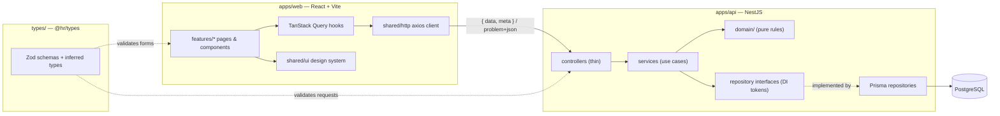

# Architecture

[← Docs index](README.md)

## Monorepo
One **pnpm workspace** with three packages:

| Package | Path | Role |
|---|---|---|
| `@hr/api` | `apps/api` | NestJS REST API, Prisma, PostgreSQL |
| `@hr/web` | `apps/web` | React + Vite single-page app |
| `@hr/types` | `types` | Zod schemas + inferred TypeScript types shared by both apps |

**Why a monorepo:** the API and the web app share one contract (`@hr/types`). Keeping them in one repo means a schema change and both its consumers land in the same commit, `pnpm typecheck` catches drift across apps, and one `pnpm install` / `pnpm dev` runs everything. pnpm was chosen for its strict, fast, disk-efficient workspaces; no extra build orchestrator (Nx, Turborepo) is needed at this size.

`@hr/types` builds to CommonJS for the API; the web app aliases its TypeScript source directly in `vite.config.ts`, so the web gets hot reload on schema changes without a build step.



## Folder structure — feature-based everywhere
```
apps/api/src/
  common/                 cross-cutting only
    errors/               framework-free domain errors (NotFound, Conflict, BusinessRule, …)
    http/                 error filter, response envelope, Zod pipe, JSON-parse + CSRF middleware
    clock.ts · config.ts  injectable time source · validated env config
  auth/                   login, refresh, logout, guards, decorators          (see authentication.md)
  employees/              module · controller · service · repository · prisma repository · errors
    profile-image/        file-storage port + local-disk implementation, image signature sniffing
  departments/            read-only reference data, same shape
  payroll/
    domain/               payroll-calculator.ts — pure TS, no Nest/Prisma/HTTP
    tax-tables/ · social-insurance/ · pay-items/ · payslip/   one flat module each
  docs/                   OpenAPI generated from the Zod schemas
  prisma/                 PrismaService (schema, migrations, seed live in apps/api/prisma/)
apps/api/test/            e2e suites + in-memory fakes and builders

apps/web/src/
  app/                    providers, router, layout, not-found page
  features/<feature>/
    api/                  axios calls + TanStack Query hooks + query keys
    components/           presentational components, no business logic
    form/                 form values ↔ schema mapping
    pages/                route-level composition
    <feature>.scss        styles colocated with the feature
  shared/
    http/                 axios client + ApiError, CSRF header, one shared refresh on 401
    forms/                schema resolver, server-error → field mapping, discard-changes guard
    ui/                   design system (Button, TextInput, Drawer, Toast, Pagination, ErrorView, …)
    theme/                design tokens (CSS custom properties) + breakpoints
    format/ · hooks/      money/date formatting, debounced value

types/src/
  common/                 ApiResponse, ProblemDetails, pagination, dates, id param
  employees/ · payroll/ · auth/

specs/<feature>/spec.md   the approved spec each feature was built from
```

## API layering — flat Nest modules + dependency inversion
Every feature is one flat Nest module with the same files:

| File | Responsibility |
|---|---|
| `<feature>.controller.ts` | Thin: validate input with the shared Zod schema, call **one** service method, return the result |
| `<feature>.service.ts` | Use cases and business rules. Depends on the repository **interface** via an injection token — never on Prisma |
| `<feature>.repository.ts` | Repository interface + DI token (e.g. `EMPLOYEE_REPOSITORY`) |
| `prisma-<feature>.repository.ts` | Prisma implementation. Prisma types never leak past it; unique-constraint races become `ConflictError` here |
| `<feature>.errors.ts` | Domain errors as plain classes (no `HttpException`) |
| `domain/` | Only for real business engines (the payroll calculator). Pure TypeScript |

**Why:** services are tested against in-memory fakes (fast, no database), the database layer can be swapped, and HTTP concerns (status codes, response shape) live only in the global filter and interceptor. This is the Dependency Inversion and Single Responsibility principles applied without an extra four-layer split, which would be ceremony at this size.

Other cross-cutting choices:
- **Time is injected** (`Clock`), so "today" and timestamps are deterministic in tests.
- **Config is validated** at start-up (`common/config.ts`); payroll rules (brackets, insurance rate, cap) live in the database and are validated on write — never hard-coded.
- **`configureApp()`** registers body parsing, middleware, the global filter and interceptor. `main.ts` and every e2e test call it, so tests exercise the real wiring.

## Request lifecycle (API)
```
request
  → JSON body parser → JSON-parse-error middleware (malformed JSON → 400)
  → CSRF header middleware (non-GET without X-Requested-With → 403)
  → JwtAuthGuard (access_token cookie) → RolesGuard (@Roles('HR'))
  → ZodValidationPipe (shared schema: body / query / params)
  → controller → service → repository interface → Prisma
  → ResponseEnvelopeInterceptor → { data, meta? }
  ✗ any thrown error → ErrorDetailsFilter → application/problem+json
```

## Web layering
- **Pages** compose components and hooks; **components** are presentational; **hooks** in `features/<feature>/api/` own server state via TanStack Query (caching, invalidation after mutations).
- **One HTTP client** (`shared/http/http-client.ts`) turns every non-2xx into an `ApiError` carrying the Problem Details body.
- **Forms** use react-hook-form with the same Zod schema the API enforces.
- **Styling:** plain SCSS with BEM, theme tokens only (no raw colours or sizes), mobile first, flexbox + `gap`.
- **Routing:** `react-router-dom` — `/employees`, `/settings/tax-tables`, `/settings/social-insurance`, `/login`.

## Data model (PostgreSQL via Prisma)
| Table | Key points |
|---|---|
| `Department` | seeded, read-only, unique name |
| `Employee` | email unique (case-insensitive, forever), `baseSalary NUMERIC(12,2)`, `status`, `type` (HR / EMPLOYEE), `deletedAt` (soft delete), optional `taxTableId` |
| `TaxTable` / `TaxBracket` | exactly one default table; brackets ordered by `position`, `upTo NUMERIC(12,2)` nullable (open bracket), `rate NUMERIC(5,2)` |
| `SocialInsuranceSettings` | single row: `rate`, optional `cap` |
| `EmployeePayItem` | `ALLOWANCE` / `DEDUCTION`, name, amount, position |
| `User` / `RefreshToken` | one user per employee; refresh tokens stored only as SHA-256 hashes |
